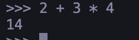
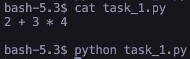
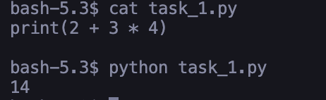

   # Отчет по лабораторной работе №1
   
   # Цель работы
   Выяснить как CPython выполняет программу, научиться отличать имя от объекта, корректно применять операции сравнения и работать с базовыми типами данных Python.

   ## Задание 1

   ### Часть 1

   При работе с REPL после вставки выражения его значения было выведено

   

   При вставке выражения в файл после запуска ничего не вывелось

   

   Для вывода результата в файле необходимо добавить функцию `print`, которая будет окружать выражение

   

   Интерактивный интерпретатор работает в цикле: прочитать -> вычислить -> вывести результат, REPL выводит результат выражений если он не None, а в файле результат работы выражения должен быть явно обработан, например выведен через print

   То есть чтобы вывести значение выражения `2 + 3 * 4` его необходимо поместить внутрь функции print: `print(2+3*4)`

   ### Часть 2

   В файл был добавлен код из инструктажа. В нем первая строка (`course = "Python"`) содержит присваивание значения переменной, что является инструкцией и литерал "Python" который и присваивается в качестве значения переменной
   Также в программе на второй строке присутствуют литералы `4` и `2`, которые вместе с знаком умножения образуют выражение, результат которой присваивается переменной `hours`.
   В третьей строке выражением является f-строка, которая подставляя значения используемых переменных возвращает новую строку, внутри f-строки строковые `": "` и `" часов"` являются литералами. Также выражением является конструкция `print(...)` но вся строка является выражением-инструкцией. 

   При выполнении программы создаются имена `course` и  `hours`

   ### Часть 3

   Версия интерпретатора: `Python 3.13.13`

   Узел соответствующий присваиванию(в 1 строке)

   ```
      Assign(
            targets=[
               Name(id='course', ctx=Store())],
            value=Constant(value='Python'))
   ```

   Узел соответствующий математической операции

   ```
         BinOp(
               left=Constant(value=4),
               op=Mult(),
               right=Constant(value=2))
   ```

   Узел соответствуюший вызову print

   ```
         Expr(
            value=Call(
               func=Name(id='print', ctx=Load()),
               args=[
                  JoinedStr(
                     values=[
                        FormattedValue(
                           value=Name(id='course', ctx=Load()),
                           conversion=-1),
                        Constant(value=': '),
                        FormattedValue(
                           value=Name(id='hours', ctx=Load()),
                           conversion=-1),
                        Constant(value=' часов')])]))
   ```

   Анализируя байт код можно найти фрагменты отвечающие за загрузку констант, а именно

   `1           LOAD_CONST               1 ('Python')` - загружает литерал "Python"

   `2           LOAD_CONST               2 (8)` - Загружает 8, в исходном коде это было выражение, но оно было вычислено CPython и встроено в байт код уже вычисленным

   ```
   3           LOAD_NAME                0 (print)
               CALL                     1
   ```

   Инструкции выше загружают функцию `print` и вызывают ее

   Ответ на контрольный вопрос: python байткод нельзя считать машинным кодом процессора потому что он не выполняется на процессоре напрямую, вместо этого он передается виртуальной машине python, которая уже выполняет его. Именно поэтому код на python платформонезависим

   ## Задание 2

   Прогнозы сравнений

   | Выражение | Прогноз                     | Вывод   |
   | --------- | --------------------------- | ------- |
   | a == b    | `True`(численно равны)      | `True`  |
   | a is b    | `True`(один и тот же обект) | `True`  |
   | a == c    | `True`(численно равны)      | `True`  |
   | a is c    | `False`(разные объекты)     | `False` |

   Мой прогноз совпал с практическим выводом

   ```mermaid
   flowchart TD
   A[Переменная a] --> B[Объект 1]
   C[Переменная b] --> B
   D[Переменная c] --> E[Объект 2]
   ```

   Разница между равенством значений и идентичностью объектов заключается в том, какие объекты мы сравниваем. Переменные a и c равны по значению, так как объекты на которые они ссылаются имеют одно и то же числовое значение(1000), но a и c не идентичны, так как они являются разными объектами. В то же время a и b ссылаются на один и тот же объект, поэтому они и идентичны.

   Значение c было изменено на None после основного кода. Правильная проверка на `None` - `c is None`. Так как все `None` значения являются одним и тем же объектом.

   После выполнения фрагмента

   ```python
   first = "python"
   second = "py" + "thon"

   print(first == second)
   print(first is second)
   ```

   Был получен результат `True`, `True`, а ожидал я `True`, `False`. Объяснить это можно тем, что на этапе перевода в байткод была проведено вычисление и во вторую переменную сразу загружается значение "python". Реализация CPython создала один объект и обе переменные ссылаются на него, но это поведение зависит от реализации, а не от стандарта языка, поэтому на него нельзя опираться.

   Можно сформулировать правило, когда применять _==_, а когда _is_:

   1. _==_ применяется для сравнения значений объектов
   2. _is_ применяется для того, чтобы выяснить, является ли результат двух выражений одним и тем же объектом / ссылаются ли две переменные на один и тот же объект. Для сравнения значений на него полагаться нельзя, так как он может вести себя по разному в разных ситуациях

   ### Ответы на контрольные вопросы

   3. Инструкция b = a не создает копию объекта а присваивает переменной b ссылку на тот же объект, что и a
   4. `type()` возвращает объект класса, которому принадлежит переданный объект, а `id()` возвращает число, которое уникально идентифицирует объект во время его жизни
   5. `None` сравнивают с помощью _is_ потому что все `None` значения имеют один и тот же id, так как None существует в памяти в единственном экземпляре. А числа и строки даже при равных значениях могут находиться в памяти на разных адресах.

   ## Задание 3

   ### Эксперимент A

   | Операция | Прогноз   | Результат | Тип   |
   | -------- | --------- | --------- | ----- |
   | `x+y`    | `22`      | `22`      | int   |
   | `x-y`    | `12`      | `12`      | int   |
   | `x*y`    | `85`      | `85`      | int   |
   | `x/y`    | `3.4`     | `3.4`     | float |
   | `x//y`   | `3`       | `3`       | int   |
   | `x%y`    | `2`       | `2`       | int   |
   | `x**y`   | `1419857` | `1419857` | int   |


   Я спрогнозировал также типы данных для `x/y` - `float` и `x//y` - `int`. Мой прогноз совпал с значениями вывода.

   Операции `/` и `//` возвращают разные значения, так как это разные операции. Одинарный слеш - это обычное деление и оно всегда возвращает `float`, а двойной слеш - целочисленное деление и возвращает float только если в делении участвует float, при этом происходит округление вниз, то есть например `-5 // 2 == -3`

   ### Эксперимент B

   Результатом эксперимента является то, что было выведено большое число без ошибки переполнения.

   Числа в CPython хранятся не как прямое значение фиксированной длины в оперативной памяти, а как объект переменной длины и поэтому они могут принимать большие значения без переполнения. Число хранится как набор цифр в большой системе счисления, на цифру в CPython приходится 30 бит(в 64 битной системе). Если число очень большое, то оно использует несколько цифр.

   ### Эксперимент C

   При выполнении операции получается `0.30000000000000004`. Это происходит из-за того, что числа `0.1` и `0.2` не являются конечными двоичными числами в представлении через мантиссу и экспоненту. Дальнейшие операции с этим числом работают штатно и показывают что оно не равно `0.3`, `result - 0.3` дает разность в `5.551115123125783e-17`, при этом `math.isclose()` показывает `True` так как это число близко к 0.3.

   Для безопасного сравнения следует использовать `math.isclose()` с подходящими допусками.

   ### Эксперимент D

   | Операция         | Прогноз(без типов) | Результат                           | Расхождение |
   | ---------------- | ------------------ | ----------------------------------- | ----------- |
   | `int("42")`      | `42`               | `42 <class 'int'>`                  | нет         |
   | `float("3.14")`  | `3.14`             | `3.14 <class 'float'>`              | нет         |
   | `str(2026)`      | `2026`             | `2026 <class 'str'>`                | нет         |
   | `bool(0)`        | `False`            | `False <class 'bool'>`              | нет         |
   | `bool(-1)`       | `True`             | `True <class 'bool'>`               | нет         |
   | `bool("")`       | `False`            | `False <class 'bool'>`              | нет         |
   | `bool("False")`  | `True`             | `True <class 'bool'>`               | нет         |
   | `complex(2, -3)` | `(2-3j) 2.0 -3.0`  | `(2-3j) 2.0 -3.0 <class 'complex'>` | нет         |

   `bool("False")` дает значение `True` так как `bool` становится `False` если в качестве аргумента ему был передан объект с пустым/нулевым значением, то есть например пустая строка или число `0`. А строка "False" не является пустой строкой и поэтому преобразуется в `True`. Действительная и мнимая часть комплексного числа выводятся через `number.real` и `number.imag` соответственно и выводятся они в float.

   ### Ответы на контрольные вопросы

   1. В отличие от других языков программирования где значение деления зависит от типов объектов которые в нем участвуют, в python результат деления зависит от применяемого действия, обычное деление на выходе всегда будет давать `float`, а целочисленное будет выдавать `float` если один из операндов `float`, в противном случае `int`.
   2. При преобразовании из строки в `int` происходит посимвольный разбор переданной строки и полученные символы переводятся в цифры, а из них в число, а при преобразовании из `float` в `int` отбрасывается дробная часть без округления.
   3. `Falsу` равны следующие значения: "" и 0.

   ## Задание 4

   В результате выполнения эксперимента был получен вывод соответствующий заданию:

   ```
   Первый символ имени: А
   Последний символ имени: а
   Имя: Анна
   Фамилия: Смирнова
   Нижний регистр: анна смирнова
   Верхний регистр: АННА СМИРНОВА
   Инициалы: А.С.
   Название в обратном порядке: nohtyP ан яинавориммаргорп ывонсО
   Анна Смирнова - Основы программирования на Python: 7/10 (70.0%) # (3 раза с разными реализациями)

   Я
   Позиция: 1071
   Восстановленный символ Я
   Закодированный символ: b'\xd0\xaf'
   Длина закодированного символа 2
   ```

   При попытке изменения символа в строке через присваивание по индексу была получена ошибка `TypeError: 'str' object does not support item assignment`. Ошибка возникает из-за того, что строка является неизменяемым объектом, а ошибка означает что к ней нельзя применить присваивание по индексу

   ### Ответы на контрольные вопросы

   1. Длина отличается потому что исходный символ(Я) имеет длину 1, но при `symbol.encode("utf-8")` возвращается последовательность байтов utf-8. Символы Unicode в UTF-8 кодируются количеством байт от 1 до 4, а символ "Я" занимает 2 байта, поэтому и `len(symbol.encode("utf-8"))` равно 2.
   2. В записи среза `text[start:stop:step]` границы означают следующее: `start` - индекс начала среза, элемент с индексом `start` будет включен в срез, `stop` - индекс следующего за последним элементом срезе, то есть последним символом в срезе будет элемент с индексом `stop-1`, параметр `step` опционален, он задает изменение индекса между элементами среза, начиная с элемента с индексом `start`, то есть индексы элементов которые захватываются step будут подчиняться формуле `start + n * k`, где k идет от 0 до того момента пока результат формулы меньше `stop`. Если step < 0 то движение будет проходить справа налево, если `step` не указан, он равен 1.
   3. Строка - неизменяемый объект и методы над ней ее не меняют, а создают новую строку, например `upper()` создает и возвращает новую строку в которой все символы заглавные

   ## Задание 5

   1. Связь имени из программы с типами объектов

   | Имя переменной     | Тип объекта |
   | ------------------ | ----------- |
   | researcher_name    | str         |
   | experiment_name    | str         |
   | launch_count       | int         |
   | launch_duration    | float       |
   | re_coef            | float       |
   | im_coef            | float       |
   | total_duration_sec | float       |
   | total_duration_min | float       |
   | coef               | complex     |
   | coef_mod_square    | float       |
   | has_runs           | bool        |

   2. Для примера возьем строку `total_duration_min = total_duration_sec / 60`. В ней `total_duration_min`, `total_duration_sec` - имена, `=` - оператор присваивания, `/` - арифметический оператор,  `60` - числовой литерал, вызовов функции нет
   3. Исходный файл — файл с расширением `.py`. CPython считывает файл, проводит синтаксический и лексический разбор и на его основе строит абстрактное синтаксическое дерево. Затем компилятор анализирует AST, определяет области видимости имен, строит таблицу символов, после преобразует AST в байткод, который исполняется виртуальной машиной CPython.
   4. Результат `input()` необходимо преобразовывать, потому что возвращаемое значение имеет тип `str`, а с ним невозможно выполнять числовые арифметические вычисления, поэтому для их проведения необходимо преобразовать его в необходимый тип(например `int` или `float`).

   ### Ответ на контрольный вопрос

   После повторного присваивания имя начнет указывать на новый объект, если на старый объект больше нет ссылок, он станет недоступен и его память может быть освобождена.

   ## Вывод

   Неожиданными особенностями python оказалось поведение целочисленного деления которое может возвращать float, а также то, что оно не отсекает дробную часть, а округляет вниз. Я ожидал что оно всегда будет возращать int и просто обрезать дробную часть вместо округления.
   Второй особенностью можно назвать невозможность точного представления некоторых десятичных дробей через float из-за особенностей двоичного представления чисел с плавающей точкой. Ожидалось что все дроби будут храниться точно.
   Третья особенность - то, что `int` имеет переменную длину и хранится как набор цифр в системе счисления с большим основанием. Ожидалось что у чисел есть лимит привязанный к типовым длинам переменных целых чисел, как в других языках программирования.
