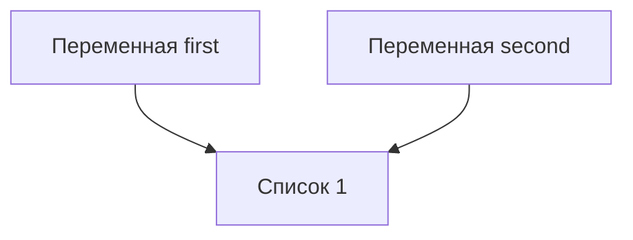
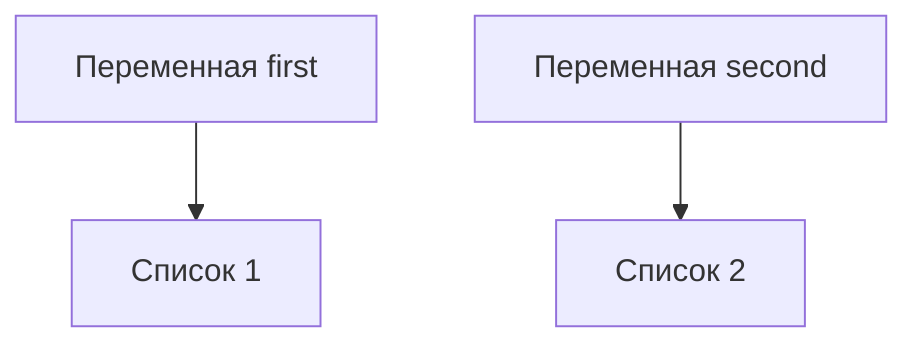
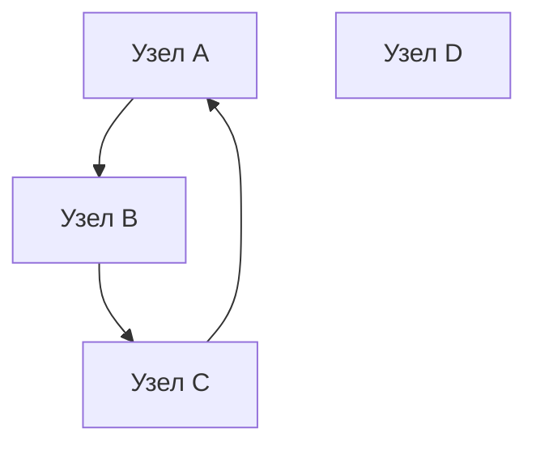

# Отчет по лабораторной работе №2

## Цель работы
Исследовать связь между объектами, понять различия между присваиванием, поверхностным и глубоким копированием, а также познакомиться с механизмами управления памятью в CPython.

## Задание 1
### Эксперимент A
Результат эксперимента:
```
a, b: 10 10
id(a), (b): 4371081808 4371081808
a, b: 11 10
id(a), (b): 4371081840 4371081808
```
`int` является неизменяемым типом и поэтому при `a+=1` новое значение не может быть записано в тот же объект, поэтому создается новый объект с значением `11`. `b` же продолжает ссылаться на объект со значением `10`

### Эксперимент B
Результат эксперимента:
```
Оба имени указывают на один объект
first, second: [10, 20] [10, 20]
id(first), id(second): 4309856384 4309856384
После изменения объекта через одно имя поменялось и значение получаемое через второе
first, second: [10, 20, 30] [10, 20, 30]
id(first), id(second): 4309856384 4309856384
```
Мы видим, что идентификаторы объектов не изменились после добавления нового элемента, а также изменилось значение обеих переменных при изменении `second`. 
После дополнения программы переназначением `second` были получены следующие результаты:
```
first == second: True
first is second: False
```
Мы видим, что списки с которыми связаны имена равны, но уже не связаны с одним и тем же объектом. При присваивании имени нового списка, созданного через определение списка с данными, создался новый объект. Хоть он и равен по значениям второму объекту но является другим, а значит при проверке `is` он покажет `False`. 

После изменения второго списка при помощи `append` был получен следующий вывод, так как они теперь не только ссылаются на разные объекты, но эти объекты еще и не равны, ожидаемо, первый список не изменился.
```
first == second: False
first is second: False
```

Схема связей до переназначения

Схема связей после переназначения


### Таблица прогнозов и результатов
| Эксперимент                | Ожидаемый результат                                                             | Фактический результат |
| -------------------------- | ------------------------------------------------------------------------------- | --------------------- |
| A: `a += 1`                | `a` станет 11, `b` останется 10                                                 | Совпал с прогнозом    |
| B: `second.append(30)`     | Изменение будет видно через оба имени                                           | Совпал с прогнозом    |
| B: переназначение `second` | `==` будет True, `is` будет False                                               | Совпал с прогнозом    |
| B: изменение нового списка | Изменится только `second`                                                       | Совпал с прогнозом    |
| Практическая задача        | После присваивания конфигурации будут общими, после `deepcopy()` — независимыми | Совпал с прогнозом    |

### Практическая задача
Для теста я создал следующую структуру
```python
config1 = {
    "name": "Название 1",
    "participants": ["Участник 1", "Участник 2", "Участник 3"],
    "parameters": [["param-1-1", "param-1-2"], ["param-2-1", "param-2-2"]],
}
```

Я создал `config2` через присваивание и после произвел изменение в `config1`
```python
config1["parameters"][0] = ["param-3-1", "param-3-2"]
```
Вывод значений показал, что изменения произошли как в `config1`, так и в `config2`. Для создания полной копии структуры я воспользовался функцией `deepcopy` из пакета `copy`. 
Идентичность и равенство были проверены через `assert`. И он выполняется после простого присваивания, а после `deepcopy` я проверяю, что значений, которые я добавил в `config1` нет в `config2`, `assert` не вызывает ошибку, а значит вторая структура не изменилась.

### Ответы на вопросы для анализа
1. Присваивание не меняет сам объект, а создает связь с новым именем, таким образом можно достичь того, что на один объект ссылается несколько имен
2. Операции с неизменяемыми объектами создают новый объект, если такого объекта уже не было создано, например `a=200` ссылается на один объект, а при `a+=1` будет создан новый объект или получена ссылка на существующий в памяти объект и он будет связан с `a`
3. Чтобы определить что два имени обозначают один объект нужно проверить их при помощи оператора `is`

## Задание 2
Я прогнозировал, что после `append` в внешнюю структуру, новое значение можно будет получить через имя оригинала и `alias`, а при изменении значения в существующем вложенном объекте, значение останется неизменным только в `deepcopy`. Мои прогнозы совпали с экспериментами.

Я провел сравнения для всех четырех структур, и составил следующую таблицу.
| Операция            | Новый внешний объект | Новые вложенные объекты | Изменения независимы                                                                                                                                                            |
| ------------------- | -------------------- | ----------------------- | ------------------------------------------------------------------------------------------------------------------------------------------------------------------------------- |
| Присваивание        | нет                  | нет                     | нет                                                                                                                                                                             |
| Поверхностная копия | да                   | нет                     | частично, при изменении внешнего объекта, изменения не отразятся на оригинале, но при изменении внутреннего объекта присутствующего в оригинале, в этой копии он тоже изменится |
| Глубокая копия      | да                   | да                      | полностью независимые изменения                                                                                                                                                 |

В операциях с матрицами при изменении первого числа в строке соответствующий столбец(первый) изменился во всех строках. Это происходит из-за того что при формировании матрицы используется умножение списка на число, что дает в результате один и тот же объект несколько раз и получается что каждая строка в внешнем списке ссылается на одну и ту же строку.
В правильной матрице же при изменении первого элемента первой строки изменяется только он, потому что она была инициализирована так, чтобы все строки из внешнего списка указывали на новые объекты. Ниже представлены результаты эксперимента в виде таблицы.


| Эксперимент                | Ожидаемый результат                             | Фактический результат  |
| -------------------------- | ----------------------------------------------- | ---------------------- |
| `wrong_matrix[0][0] = 1`   | во всех строках первый элемент станет 1         | совпал с предсказанием |
| `correct_matrix[0][0] = 1` | первый элемент изменится только в первой строке | совпал с предсказанием |


### Ответы на вопросы для анализа
1. Поверхностная копия для вложенных объектов создает новый внешний объект и помещает в него те же внутренние объекты, что и в оригинале. Глубокая же копия в рассматриваемом эксперименте создает все вложенные объекты заново, кроме неизменяемых, получается что новый объект из глубокой копии полностью независим от оригинала.
2. Глубокое копирование создает копию вложенных объектов, кроме неизменяемых. Это может привести к перерасходу памяти, когда меняться будут только определенные объекты а скопированы были все.
3. Поверхностной копии достаточно, когда предполагается изменение только верхнего уровня копируемой структуры. Также возможно, когда копируемая структура содержит только неизменяемые объекты.

## Задание 3

После выполнения кода я увидел что `sys.getrefcount()` показывает на одну ссылку больше. Это связано с тем, что при передаче объекта в качестве аргумента на него создается временная ссылка, которая учитывается в самом `getrefcount`. Из-за этого он и показывает на одну ссылку больше. 

Счетчик увеличивает создание новых имен, которые ссылаются на изначальный объект, создание новых объектов, которые содержат ссылки на изначальный объект и временно увеличивает вызов функции, которой в аргументах передана ссылка на объект. В общем счетчик увеличивает создание новых сильных ссылок. 

Уменьшают счетчик ссылок действия, которые приводят к переназначению или удалению ссылок: присваивание переменным новых значений или удалению старых переменных.

`del alias` удаляет имя. Другие имена продолжат указывать на тот же объект, пока его счетчик ссылок не равен 0, он не будет очищен через подсчет ссылок, однако сборщик мусора может очистить его при ненулевом количестве ссылок, если объект перестал быть доступен из программы.

После дополнения программы экспериментом со слабой ссылкой я получил следующий результат: первый `print` вывел текстовую репрезентацию созданного объекта, а второй, расположенный после `del` вывел `None`. 

Слабые ссылки можно использовать для кеширования. Если создать словарь со слабыми ссылками и записывать в него объекты, а затем удалить все сильные ссылки на них, они удалятся и из словаря. При сильных ссылках все кэшированные объекты хранились бы в памяти.

### Практическая задача

Для выполнения практического задания я создал словарь `registry`, в который я записал три объекта типа `Record`. Для двух из них я предварительно создал сильные ссылки путем привязки объектов к переменным. Третий объект я создал непосредственно при помещении в реестр. 

При проверке ключей реестра непосредственно после присваивания объектов, обнаружились только ключи первых двух объектов на которые я предварительно создал сильные ссылки. После удаления сильной ссылки на второй объект и проверки ключей, остался только ключ первого объекта. Остальные были удалены механизмом подсчета ссылок.


| Действие                                         | Ожидаемый результат                                                                          | Фактический результат |
| ------------------------------------------------ | -------------------------------------------------------------------------------------------- | --------------------- |
| `weak_record()` до удаления                      | предоставляет доступ к объекту                                                               | совпал с прогнозом    |
| `weak_record()` после `del record`               | не предоставляет доступ к объекту                                                            | возвращает `None`     |
| Проверка `registry` после создания трех объектов | остались только ключи первых двух объектов, тот что был создан без сильной ссылки был удален | совпал с прогнозом    |
| Проверка `registry` после `del o_2`              | остался только ключ первого элемента                                                         | совпал с прогнозом    |


### Ответы на вопросы для анализа
1. Подсчет ссылок освобождает объект, когда на него не остается ссылок, то есть счетчик равен 0.
2. Нет, не всегда, так как CPython имеет свою организацию памяти и возвращает ее ОС он не когда удаляются объекты, а если интерпретатор принимает решение вернуть область памяти, содержащую объект системе. В противном случае память не будет возвращена системе, а продолжит использоваться программой.
3. Сильная ссылка увеличивает счетчик ссылок, а слабая - нет

## Задание 4
Программа вывела текущее состояние GC - `True`, пороги поколений - `(700, 10, 10)` и статистику поколений 
```
[{'collections': 9, 'collected': 0, 'uncollectable': 0}, {'collections': 0, 'collected': 0, 'uncollectable': 0}, {'collections': 0, 'collected': 0, 'uncollectable': 0}]
```

Ожидается что после удаления `first` и `second` `gc.collect()` вернет количество обнаруженных объектов, то есть 2. Эксперимент на практике подтвердил мой прогноз, он совпал с выводом программы, хотя gc мог найти другие объекты, например служебные объекты python и тогда вывод был бы другим.

Алгоритма подсчета ссылок недостаточно, потому что как в этом случае возникают циклические зависимости и поэтому счетчик ссылок не опускается до 0, а значит эти объекты нельзя очистить через подсчет.

Поколения `gc` нужны для оптимизации работы. Они основываются на идее: чем дольше объект существует, тем выше вероятность, что он продолжит существовать. Объекты попадают вначале в молодое поколение, на котором сборщик мусора запускается наиболее часто, если объекты переживают сборки, они двигаются вверх по поколениям, чем старше поколение, тем реже оно собирается.

Я провел дополнительный эксперимент с отключением автоматической сборки мусора и вызовом ручной сборки мусора, после удаления внешних ссылок и запуска сборки мусора было удалено три объекта, созданных мной. Я прогнозировал то, что после удаления имен, сборщик мусора найдет и освободит недоступные из программы объекты.

### Практическая задача

Я выполнил практическую задачу: перед созданием графа я вызвал `gc.collect()` и он вернул 0, а после создания графа, удаления внешних имен циклических объектов, сборки мусора и вывода количества собранных объектов я получил 6 - в два раза больше чем количество циклических узлов, так как были очищены словари узлов и вложенные в них списки со связями. Это разошлось с моим прогнозом, потому что я предположил, что объектов будет найдено 3, но я не учел вложенные списки. Независимый узел остался доступен, так как мы не удаляли его внешнее имя, поэтому его не очищал не механизм подсчета ссылок, ни сборщик мусора. Ниже приведена схема полученного графа. 



### Ответы на вопросы для анализа
1. Циклические ссылки возникают, когда два и более объектов начинают ссылаться друг на друга или когда объект ссылается сам на себя.
2. Объект с ненулевым счетчиком ссылок может быть недостижим из программы, если оставшиеся на него ссылки это ссылки, которые хранятся в других объектах недостижимых из программы.
3. Сборщик мусора разделяет объекты по поколениям для оптимизации производительности, ведь чем старше поколение, тем реже на нем запускается сборщик мусора.

## Задание 5

### Часть 1

Размер контейнера не включает полный размер всех объектов на которые он ссылается потому что `sys.getsizeof()` подсчитывает только размер переданного ему объекта и если это объект контейнер, то в нем находятся не сами объекты, которые он содержит, а ссылки на эти объекты. Размер контейнера формируется из размера его служебных данных и памяти, выделенной на хранение ссылок на содержащиеся объекты. Ниже таблица полученная с моими результатами

| Объект                | Прогноз                                     | Фактический размер, байт |
| --------------------- | ------------------------------------------- | -----------------------: |
| Пустой список         | маленькое число из-за метаданных            |                       56 |
| Список из 10 чисел    | больше пустого списка                       |                      152 |
| Кортеж из 10 чисел    | меньше списка из-за отсутствия избыточности |                      120 |
| Строка из 10 символов | больше 0, около 20                          |                       59 |
| `int`                 | 2/4/8                                       |                       28 |
| `None`                | больше нуля из-за метаданных                |                       16 |

### Часть 2

Я провел эксперимент второй части. Размер списка не увеличивается после каждого append, так как место резервируется с запасом. Это происходит в целях оптимизации, для того, чтобы избежать лишних аллокации памяти. Длина списка отличается от объема выделенной памяти тем, что длина - количество элементов содержащихся в списке, а объем выделенной памяти определяет сколько ссылок на элементы сможет хранить список, он может быть выделен с запасом и содержать места под большее количество ссылок, чем хранится в списке сейчас. Это совпало с моим прогнозом, я ожидал, что для оптимизации аллокаций памяти список будет расширяться с запасом, но я не знал, что запас на который увеличивается список зависит от его размера.


| Длина списка | Размер списка, байт | Увеличение размера, байт |
| -----------: | ------------------: | -----------------------: |
|            0 |                  56 |                        — |
|            1 |                  88 |                      +32 |
|            5 |                 120 |                      +32 |
|            9 |                 184 |                      +64 |
|           17 |                 248 |                      +64 |
|           25 |                 312 |                      +64 |
|           33 |                 376 |                      +64 |
|           41 |                 472 |                      +96 |
|           53 |                 568 |                      +96 |
|           65 |                 664 |                      +96 |
|           77 |                 792 |                     +128 |
|           93 |                 920 |                     +128 |
  

### Часть 3

Я провел эксперимент и получил разные результаты для `numbers = list(range(100_000))` и `numbers = range(100_000)`. Это можно объяснить тем, что в первом случае в переменную `numbers` записывается список у которого 100 000 элементов, а во втором объект `range`, который представляет арифметическую последовательность с определенными параметрами. То есть в первом случае в памяти сохранились 100 000 целых чисел а во втором объект, который эти числа возвращает по определенному правилу.


| Сценарий               | Прогноз потребления памяти | Фактический пик, КБ |
| ---------------------- | -------------------------- | ------------------: |
| `list(range(100_000))` | Больше памяти              |          3508.77344 |
| `range(100_000)`       | Меньше памяти              |             0.10938 |


### Практическая задача

Я вынес замеры памяти в `memory_report.py`. Он сначала собирает данные обоих замеров в словарь, а затем выводит их. Отдельно выводится соотношение пиковой памяти.  
```
==============================
Название эксперимента: Тест 1 - материализация range
Число элементов: 100000
Размер внешнего объекта: 800056
Текущий объем выделеной памяти: 3508.65234КБ
Пиковый объем выделеной памяти: 3508.77344КБ
==============================
Название эксперимента: Тест 2 - хранение range
Число элементов: 100000
Размер внешнего объекта: 48
Текущий объем выделеной памяти: 0.07422КБ
Пиковый объем выделеной памяти: 0.10938КБ
==============================
Отношение пикового объема двух сценариев: 32080.214
```

### Итоговый анализ

#### Способы уменьшения потребления памяти:
1. Не использовать копирование, особенно глубокое без явной необходимости - эксперимент задания 2
2. Избегать циклических связей между объектами, чтобы при окончании работы с ними они освобождались механизмом подсчета ссылок, а не сборщиком мусора - эксперимент задания 4
3. Использовать структуры, которые не материализуют большой объем данных в памяти без явной необходимости, лучше использовать различные генераторы, являющиеся итераторами или объекты `range`, являющиеся неизменяемыми последовательностями вычисляемую на лету - эксперимент задания 5

#### Опасные ошибки при работе с изменяемыми типами
1. Работа с переданными в функцию списками напрямую без копирования. Это приводит к модификации данных, которые нельзя модифицировать.
2. Вложенные списки нужно создавать через генераторы, не через умножение, так как это приводит к тому, что все списки, которые были получены умножением являются одним и тем же объектом
3. Использование поверхностного копирования, когда предполагается изменение вложенных данных, ошибка схожая с п.1