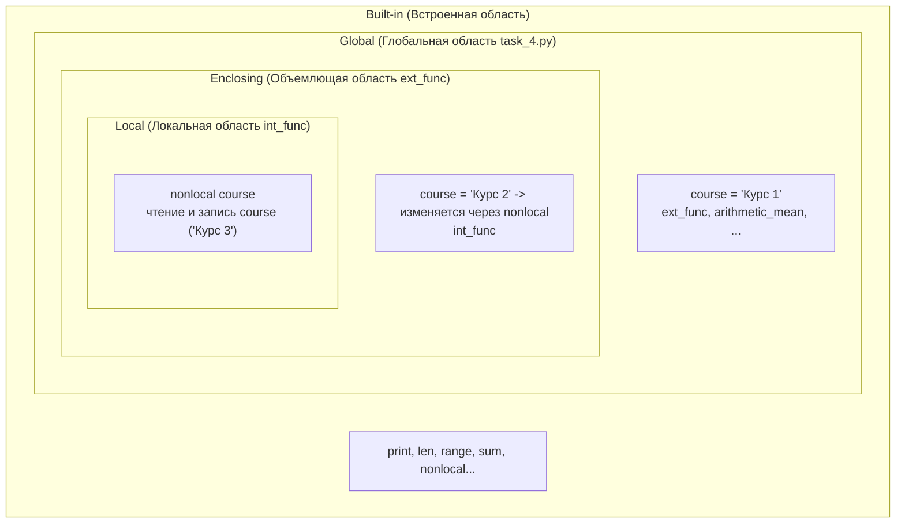

# Отчет по лабораторной работе №3
   
# Цель работы
Научиться переводить условия задачи в алгоритм, выбирать нужные структуры данных и разделять программу на малые функции.

## Задание 1
### Часть 1
Проверка значений вынесена в отдельную функцию `check_inputs`. Она производится через `if`, `elif`. Если обнаруживается некорректный ввод, функция печатает в вывод сообщение о некорректном вводе, а затем возвращает `False`. Если все выводы верные, возвращается `True`. Для дальнейшего выполнения программы, дальнейшие вызовы находятся в `if check_inputs`

### Часть 2
Уровень переводится из баллов в отдельной функции через промежуточное формирование числового представление успеваемости через `if/elif`. Если пропусков больше трех и числовое представление больше нуля, то из него вычитается 1 для понижения уровня. Затем он через `match` преобразуется в строковое значение и возвращается.

### Часть 3
Через отдельную функцию формируется текстовое представление вида работы. Внутри используется `match` для сравнения значений. Значение по умолчанию выводит неизвестный тип работы. 


### Часть 4
| Балл | Тип работы | Пропуски | Ожидаемый результат                                    | Фактический результат |
| ---: | ---------- | -------: | ------------------------------------------------------ | --------------------- |
|    0 | exam       |        0 | экзаменационная работа - недостаточный                 | совпал                |
|   59 | practice   |        3 | практическая работа - недостаточный                    | совпал                |
|   60 | project    |        4 | проектная работа - недостаточный                       | совпал                |
|   74 | exam       |        5 | экзаменационная работа - недостаточный                 | совпал                |
|   75 | practice   |        2 | практическая работа - хороший                          | совпал                |
|   89 | project    |        4 | проектная работа - удовлетворительный                  | совпал                |
|   90 | exam       |        3 | экзаменационная работа - отличный                      | совпал                |
|  100 | project    |        5 | проектная работа - хороший                             | совпал                |
|   50 | practice   |        4 | практическая работа - недостаточный                    | совпал                |
|  101 | exam       |        2 | Результат студента должен быть числом от 0 до 100      | совпал                |
|   85 | project    |        6 | Количество пропущенных занятий должно быть не больше 5 | совпал                |
|   92 | unknown    |        1 | неизвестный тип - unknown - отличный                   | совпал                |

#### Порядок проверки условий и достижимость ветвей
1. В функции `check_inputs` сначала проверяется диапазон балла (`not 0 <= student_result <= 100`), затем количество пропусков (`not 0 <= missed_classes <= 5`). Проверка типа работы здесь не отсекает выполнение, так как для неизвестного типа предусмотрена ветвь в `match/case`.
2. В `calculate_grade` условия идут от меньших баллов к большим: `< 60`, `60..74`, `75..89`, `else` (соответствует `>= 90`). При таком каскаде все ветви достижимы, так как диапазоны не перекрываются и полностью покрывают отрезок $[0, 100]$.
3. Недостижимых ветвей в реализации нет: граничные условия отделены, а ветвь `_` ловит неизвестные значения.

### Практическое расширение

Практическое расширение я реализовал с использованием цикла `for` с распаковкой значений в переменные и переиспользованием ранее написанных функций. 
| Уровень            | Количество студентов |
| ------------------ | -------------------: |
| Отличный           |                    2 |
| Хороший            |                    2 |
| Удовлетворительный |                    1 |
| Недостаточный      |                    5 |
| **Всего**          |                   10 |
Несовпадение количества тестовых данных с суммой данных можно объяснить тем, что в тестовых данных два набора были рассчитаны на то, чтобы вызвать ошибку, соответственно они не попали в статистику.

## Задание 2
Я реализовал получение всех данных кроме количества элементов больше среднего арифметического за один проход. Сумма считается сложением всех элементов, минимальный элемент через сравнение текущего элемента с кандидатом на минимальный/максимальный элемент и переприсваиванием, четные элементы считаются через равенство остатка от деления с 0, также подсчитываются все элементы для последующего просмотра среднего арифметического. После первого прохода вычисляется среднее арифметическое, затем выполняется второй проход с сравнением среднего арифметического с текущим элементом и увеличением счетчика.

Я реализовал линейный поиск через функцию, чтобы иметь возможность вернуть индекс элемента до полного прохода. Если элемент не найден возвращается `-1`.

### Дополнительный алгоритмический эксперимент

#### Псевдокод алгоритма проверки простоты
```text
ФУНКЦИЯ is_simple(n):
    ЕСЛИ n < 2 ТО:
        ВЕРНУТЬ Ложь
    ДЛЯ i ОТ 2 ДО целая_часть(корень(n)):
        ЕСЛИ n ОСТАТОК_ОТ_ДЕЛЕНИЯ i == 0 ТО:
            ВЕРНУТЬ Ложь
    ВЕРНУТЬ Истина
```

Я реализовал алгоритм проверки простоты числа через перебор делителей до квадратного корня, временная сложность данного алгоритма - $O(\sqrt n)$. Количество операций зависит от проверяемого числа, Если оценивать дополнительную память, то получается $O(1)$, однако при точной оценке получаем что программа выделяет память под переменную в которую записываются значения из `range`. Ограничение делителей квадратным корнем корректно, так как если число представить в качестве составного, то делители будут идти парами, а если продолжить перебор после корня, мы просто дойдем до второго элемента пары.

### Практическое расширение

#### Псевдокод сортировки выбором
```text
ФУНКЦИЯ select_sort(data, n):
    ДЛЯ i ОТ 0 ДО n - 2:
        cur_min_index = i
        ДЛЯ j ОТ i + 1 ДО n - 1:
            ЕСЛИ data[j] < data[cur_min_index] ТО:
                cur_min_index = j
        ОБМЕНЯТЬ data[i] И data[cur_min_index]
    ВЕРНУТЬ data
```

#### Псевдокод бинарного поиска
```text
ФУНКЦИЯ bin_search(data, start, stop, target):
    ЕСЛИ start > stop ТО:
        ВЕРНУТЬ -1
    mid = (start + stop) // 2
    ЕСЛИ data[mid] > target ТО:
        ВЕРНУТЬ bin_search(data, start, mid - 1, target)
    ИНАЧЕ ЕСЛИ data[mid] < target ТО:
        ВЕРНУТЬ bin_search(data, mid + 1, stop, target)
    ИНАЧЕ:
        ВЕРНУТЬ mid
```

Я использовал свои реализации алгоритмов из лабораторных по алгоритмам и структурам данных. Я доработал свои алгоритмы для подсчета числа сравнений и после провел тесты. Ниже получившаяся таблица. В ней указано количество сравнений:
| Размер | Сортировка выбором | Линейный поиск | Бинарный поиск |
| ------ | ------------------ | -------------- | -------------- |
| 10     | 45                 | 10             | 3              |
| 100    | 4950               | 100            | 6              |
| 1000   | 499500             | 1000           | 9              |

Вторая таблица — время выполнения в миллисекундах:

| Размер | Сортировка выбором | Линейный поиск | Бинарный поиск |
| -----: | -----------------: | -------------: | -------------: |
|     10 |             0.0046 |         0.0013 |         0.0025 |
|    100 |              0.157 |         0.0032 |         0.0014 |
|   1000 |            15.7806 |         0.0245 |         0.0025 |

Для сортировки и поиска я использовал худшие случаи, когда список отсортирован в обратном порядке и в нем нет искомого элемента.

## Задание 3
Я построил требуемые множества через генераторы множеств. Вот пример такого генератора: `{i[0] for i in submissions}`. Для генерации словарей для уменьшения количества кода инициализации значений я использовал `defaultdict` из библиотеки `collections`. Он автоматически инициализирует пустое значение при обращении по ключу, которого не было. Словари я заполнял через обработку циклами, где я по нужным ключам записываю нужные значения. 

Студентов, сдавших обе лабораторные, я получил через пересечение двух множеств с ними, пересечение выполняется при помощи оператора `&`. 

После добавления новой записи я добавил необходимые значения в соответствующие структуры и снова их вывел. Переходим к объяснениям заданных вопросов:
 - Множество подходит для хранения уникальных значений, так как оно не хранит повторяющиеся объекты, то есть если объект повторяется, он будет значиться в множестве только один раз.
 - Кортеж можно использовать как ключ у словаря, так как он неизменяемый и хешируемый, ключом он может стать при условии что все его элементы также хешируемые. 
 - Список нельзя использовать как ключ словаря потому что это изменяемый объект.
 - Словарь эффективнее чем список при поиске по составному ключу, так как чаще всего поиск происходит за $O(1)$, а не за $O(n)$
  
Таблица оценки средней сложности добавления и поиска в используемых коллекциях:
| Коллекция | Добавление        | Поиск  | Пояснение                       |
| --------- | ----------------- | ------ | ------------------------------- |
| `list`    | $O(1)$ в конец    | $O(n)$ | Поиск обычно через перебор      |
| `set`     | $O(1)$            | $O(1)$ | Используется хеширование        |
| `dict`    | $O(1)$            | $O(1)$ | Используется хеширование ключей |
| `tuple`   | не поддерживается | $O(n)$ | Неизменяемая последовательность |

### Практическое расширение
Парсинг и извлечение значений я реализовал через конструкцию `match`. Она может одновременно проверять сооответствие шаблону и извлекать из него значения. Перед получением значений я сделал проверки на их наличие, так как defaultdict при обращении по несуществующему ключу выдаст значение по умолчанию. Неизвестная команда обрабатывается через ветвь по умолчанию в match. Команды считываются в while и считывание закончится по получению пустой строки, то есть по нажатию клавиши ENTER. 

## Задание 4
Функцию среднего арифметического я реализовал через `sum` и `len`. 

Функция нормализации имени разбивает имя на части и одновременно вырезает лишние пробелы. Также вызывается `capitalize`, который приводит каждую часть имени к нужному формату. 

Функция построения отчета сделана через конкатенацию строк, а также итерирование по результатам студента и добавление их в отчет с номером. если результатов больше 0, то еще пишется средний балл, в нем используется форматирование знаков после запятой с точностью `precision`.

Функция очистки тегов обрабатывает список входных тегов через цикл в котором у тегов обрезаются пробелы через `strip`, а затем если передан `lowercase = True` они еще и приводятся в нижний регистр и добавляются в множество чтобы исключить дубликаты. Затем множество преобразовывается в кортеж и возвращается

После запускается ряд проверок через `assert`, которые прогоняют граничные случаи работы функций.

### Исследование LEGB



Поиск имен происходит по правилу LEGB: сначала в локальной области (**L**ocal), затем в объемлющих функциях (**E**nclosing), далее в глобальной области модуля (**G**lobal) и в конце во встроенной (**B**uilt-in). Внутри `int_func` директива `nonlocal course` указывает интерпретатору не создавать локальную переменную, а связать имя с переменной `course` из ближайшей объемлющей области `ext_func`.

После обновление переменной внутри внешней функции это не повлияло на глобальное значение этой переменной, а после обновления переменной с `nonlocal` в внутренней функции изменилось значение переменной внешней функции, но не глобальное значение. Это подтверждается выводом программы. То есть `nonlocal` в отличие от `global` дает доступ не к глобальной области а на область выше.

### Ошибка изменяемого значения по умолчанию
При тестировании функции проявилась ошибка, заключающаяся в том, что при использовании значения `values` по умолчанию используется один список и следовательно при повторных вызовах функции значение добавляется в один и тот же список. 

Исправление заключается в замене значения по умолчанию на `None` и использовании проверки на `None` с созданием нового списка каждый раз. К слову, это же решение было предложено моим линтером(ruff). 

### Практическое расширение
Я реализовал функцию `apply_to_results`, которая применяет переданную функцию к переданному списку. Внутри нее с функцией нужно работать так же, как с обычной функцией, то есть просто вызвать имя через `()`. Я провел проверку с именованной функцией и лямбдой.

Внутри функции `make_threshold_checker` я создаю внутреннюю функцию, которая сравнивает входное значение с `threshold` из внешней функции, а затем возвращаю ее как обычную переменную. В замыкании сохраняется значение, переданное при его создании.

## Задание 5

### Контракты публичных функций

| Функция                                   | Входные данные                             | Возвращаемое значение                                                                     | Особые / граничные случаи                                    |
| :---------------------------------------- | :----------------------------------------- | :---------------------------------------------------------------------------------------- | :----------------------------------------------------------- |
| `mean(values)`                            | `list[float \| int]` — список чисел        | `float` — среднее значение                                                                | При пустом списке возвращает `0.0`                           |
| `minimum(values)`                         | `list[float \| int]` — список чисел        | `float \| int` — наименьшее значение                                                      | При пустом списке возвращает `0`                             |
| `maximum(values)`                         | `list[float \| int]` — список чисел        | `float \| int` — наибольшее значение                                                      | При пустом списке возвращает `0`                             |
| `classify(score)`                         | `float \| int` — числовой балл             | `str` — текстовая категория: «недостаточный», «удовлетворительный», «хороший», «отличный» | Границы: `<60`, `60..74`, `75..89`, `>=90`                   |
| `student_summary(name, results)`          | `name: str`, `results: list[int \| float]` | `dict` со статистикой: `{"min": ..., "max": ..., "avg": ..., "cat": ...}`                 | Делегирует обработку пустого списка вспомогательным функциям |
| `find_top_students(students)`             | `dict[str, list[int \| float]]`            | `list[str]` — список имен лидеров с одинаковым наивысшим баллом                           | При пустой группе возвращает пустой список `[]`              |
| `rank_students(students)`                 | `dict[str, list[int \| float]]`            | `list[str]` — список студентов по убыванию их среднего балла                              | Исходный словарь не мутирует (копируются ключи)              |
| `group_summary(students)`                 | `dict[str, list[int \| float]]`            | `dict` со сводкой: `leaders`, `group_count`, `avg`, `ranking`                             | При пустой группе возвращает пустых лидеров и `0.0` среднее  |
| `format_report(student_data, group_data)` | `student_data: dict`, `group_data: dict`   | `str` — отформатированный многострочный отчет                                             | Корректно выводит отчет даже при пустых данных               |

### Оценка сложности построения общей статистики
В функции `group_summary` выполняются следующие шаги:
- Вычисление общего среднего: проход по всем оценкам всех студентов — $O(N)$, где $N$ — общее число оценок в группе.
- Подсчет среднего для каждого студента: суммарно также $O(N)$.
- Поиск лидеров `find_top_students`: $O(K)$, где $K$ — количество студентов.
- Ранжирование `rank_students`: поиск максимума на каждом шаге занимает в худшем случае $O(K^2)$ операций.
- Итоговая временная сложность построения сводки: $O(N + K^2)$. Дополнительная память: $O(K)$ для хранения средних баллов, рейтинга и счетчиков категорий.

Для решения этой задачи я реализовал требуемые вспомогательные функции. Затем я комбинировал базовые функции для создания комплексных, то есть в статистике студента используются функции минимума, максимума, классификации и среднего значения. Также я написал функцию построения рейтинга студентов для отчета. И последним этапом я написал форматирование отчета через f-строки. 

Я проверил программу на 6 сценариях, указанных в задании, и убедился в том, что все работает корректно.


# Вывод
Декомпозиция положительно повлияла на читаемость решения, так как теперь не нужно искать нужные фрагменты во всем исходном коде, а только в нужных функциях.