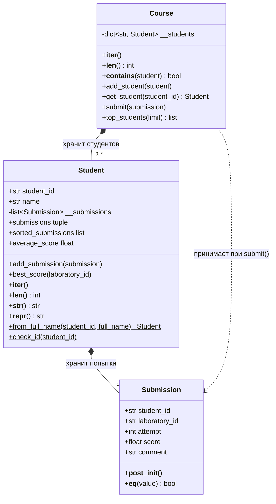

# Отчет по лабораторной работе №4

## Цель работы
Разобраться в механизмах, лежащих в основе механизма `for`, научиться создавать собственные последовательности и проектировать собственные типы, поддерживающие стандартные протоколы `python`. 

## Задание 1
При попытке вызова `next()` в четвертый раз была выброшена ошибка `StopIteration`. Также я заметил что при попытке преобразования итератора в итератор возвращается исходный итератор и поэтому `iter(obj) is obj` возвращает `True`.

Я реализовал функцию `consume`, которая соответствует заданию и проверил ее на запрошенных данных. В большинстве случаев результат выглядит просто как преобразование объекта в список. Внешние различия появляются при повторном обходе итератора. Функция вернула пустой список, так как все элементы из итератора уже были получены и новых он не вернет.

### Практическое расширение
Функцию `my_enumerate` я реализовал через цикл `for`, так как на его использование в этой функции запрета не было. Она извлекает элементы из входного итератора и записывает кортеж из значения счетчика и элемента, затем счетчик инкрементируется.

Для `my_zip` я использовал цикл `while`, так как с ним удобнее реализовать выход из функции при исчерпании одного из списков. Внутри цикла используется `try/except`, который ловит исключение `StopIteration`. Внутри `try` через `next()` получается следующие элементы входных итераторов, затем кортеж состоящий из них добавляется к выходному списку и при возникновении исключения из итератора этот список возвращается.

Я добавил проверки требуемые в задании. Они прошли корректно.

### Вопросы для анализа
1. `iter` при передаче в него итерируемого объекта вернет итератор, который возвращает элементы переданного объекта
2. `next()` после исчерпания данных вызывает исключение `StopIteration`
3. У обычного объекта `iter()` возвращает итератор по нему, а у уже созданного итератора возвращается он же.

## Задание 2
Я реализовал два класса. Первый - `StepRange` - он является фабрикой `StepRangeIter`, то есть при использовании в качестве итератора, он вернет сам класс итератора. Это необходимо для достижения независимости итераторов. В фабрике реализованы только инициализация(`__init__`) и преобразование в итератор(`__iter__`). Инициализация просто записывает переданные значения в поля класса, а преобразование в итератор - возвращает новый `StepRangeIter`. Внутри самого `StepRangeIter` также реализованы методы инициализации и преобразования в итератор. Метод реализации идентичен классу-фабрике, а вот метод `__iter__` возвращает сам объект. И самое главное для работы в качестве итератора реализован метод `__next__`. Внутри него происходит вычисление следующего элемента, затем проверка что он не выходит за границы начального и конечного значения, если не выходит, то возвращается сам элемент, если выходит, то выбрасывается исключение `StopIteration`. При шаге равном 0 инициализация класса выбросит `ValueError` с сообщением об этом. Были проведены все необходимые проверки, требуемые в задании. 

### Практическое расширение
Я реализовал метод `__len__` - он производит вычисление длины последовательности без вычисления самой последовательности. Вычисление распадается на два случая в зависимости от знака шага. Они отличаются порядком значений при вычитании. Также применяется округление вверх, потому что при некоторых шагах результат вычислений может быть нецелым. 

Затем я реализовал собственный `__contains__`. Его работа основана на том, что если элемент находится в промежутке между началом и концом последовательности и модуль разности этого элемента и начального значения последовательности без остатка делится на модуль шага последовательности, то элемент присутствует в ней. При обходе значений последовательности мы сравниваем каждый ее элемент с искомым и если находим его, то мы можем сказать, что он в ней присутствует. В худшем случае для последовательности длиной `n` мы проведем `n` сравнений. В моей реализации в любом случае мы сравниваем шаг с 0, чтобы определить как строить неравенство, а затем дважды сравниваем элемент с начальными и конечными элементами последовательности. И если он входит в этот диапазон производим сравнение остатка от деления с 0. То есть наивная реализация требует `n` сравнений для определения вхождения, а моя - 4. 

Метод `__repr__` просто формирует строку со значениями полей класса.

Эти методы общие как для фабрики, так и для самого итератора, так как они представляют одинаковую последовательность.


### Вопросы для анализа
1. Состояние обхода лучше хранить в отдельном объекте, чтобы при использовании одной и той же последовательности каждый созданный итератор был бы независим.
2. При возврате одного и того-же итератора все созданные таким образом итераторы будут одним и тем же, соответственно у них один пул элементов и одно состояние, то есть при извлечении элемента из одного итератора, извлечь этот элемент из второго будет уже невозможно, так как он вернет следующий элемент.
3. `StepRange` требует меньше памяти, чем хранение большого количества элементов: для хранения элементов нужно хранить `n` чисел и служебные данные, зависящие от выбранной структуры данных, а `StepRange` хранит только параметры последовательности. При сравнении через `sys.getsizeof()` поверхностный размер кортежа из 100 последовательных чисел и `StepRange` с теми же параметрами составил 840 и 48 байт соответственно. `sys.getsizeof()` не включает память объектов, на которые ссылаются эти объекты, поэтому это сравнение не показывает полный расход памяти.

Состояние двух независимых итераторов `StepRange(0, 5, 2)` после каждого вызова `next()`:

| Действие                     | Выдано значение | Следующее значение итератора 1 | Следующее значение итератора 2 |
| ---------------------------- | --------------: | -----------------------------: | -----------------------------: |
| Начальное состояние          |               — |                              0 |                              0 |
| `next()` у первого итератора |               0 |                              2 |                              0 |
| `next()` у второго итератора |               0 |                              2 |                              2 |
| `next()` у первого итератора |               2 |                              4 |                              2 |
| `next()` у второго итератора |               2 |                              4 |                              4 |

## Задание 3
Я реализовал функции из задания через циклические обходы и фильтрацию значений и возврат через `yield`. Он возвращает значение, приостанавливает выполнение функции, а при вызове `next()` возвращает выполнение в то же место функции. Для вычисления скользящего среднего используется `deque`, с параметром `maxlen` - так он хранит нужное количество значений. Возвращается сумма, деленная на размер окна. Для создания конвейера я составил цепочку вложенных вызовов функций и присвоил ее переменной, то есть там оказался генератор, который запускает цепочку вычисления для получения результата. После проверок с моими параметрами извлеклись два значения из конвейера, а список оставшихся значений оказался пуст. При попытке повторного подхода исчерпанного конвейера получился пустой список, а после создания нового контейнера и конвертации его в список в нем оказались два значения - те же что были извлечены через `next()`.  

Дополнительные списки, множества и словари я создавал через включения и генераторные выражения. Они отличаются тем, что включения возвращают все элементы, то есть все элементы попадают в память, а генераторные выражения возвращают генератор, который лениво вычисляет элементы, а значит не занимает память под все элементы. 

### Практическое расширение
Я реализовал универсальные генераторы принимающие итераторы, которые возвращают элементы по некоторым правилам, `take` возвращает элементы последовательности состоящей из первых `n` значений переданного итератора. `drop` наоборот возвращает элементы последовательности с `n+1` элемента переданного итератора. `batch` же возвращает списки, каждый длиной `size` элементов.

Я провел тестирование памяти и получил, что ленивое вычисление в пике занимает 1276 байт памяти, а вариант со списками в пике занимает 8266072 байт, что существенно больше. Это показывает преимущество ленивых вычислений в работе с большими значениями. Достигается это за счет того, что при ленивых вычислениях сами вычисления происходят в момент получения значения а не в момент инициализации.

## Задание 4

Диаграмма классов построена по классам из `task_4.py`:



Сплошные ромбы показывают композицию: `Student` хранит список попыток `Submission`, а `Course` — словарь студентов. При сдаче работы `Course` передает `Submission` соответствующему студенту.

Наследование между `Student` и `Submission` не является корректным и по логическим и по причинам реализации. Логически попытка сдачи не является подвидом студента, а значит он не может быть родительским классом, а реализационно они имеют разные методы и поля, а в частности родитель имеет поля которых не должно быть у потомка, как например список сдач.

Инварианты классов:

- `Submission` проверяет, что идентификаторы студента и лабораторной работы непустые, номер попытки положительный, а балл находится от 0 до 100.
- `Student` проверяет корректность ID и непустое имя. Список попыток хранится приватно, а свойство `submissions` возвращает кортеж, поэтому через него нельзя изменить внутренний список.
- `Course` хранит студентов в словаре по их ID. Перед получением студента или добавлением сдачи проверяется, что студент зарегистрирован; `top_students()` отклоняет неположительный лимит.

Пример работы стандартных функций и оператора с объектами:

```python
submission = Submission("s1", "lab1", 1, 90)
student = Student("s1", "Анна")
student.add_submission(submission)
course = Course()
course.add_student(student)

print(len(student))                  # 1 — количество попыток
print(next(iter(student)))           # Submission(...)
print(submission in student)         # True — поиск перебирает попытки
print(len(course))                   # 1 — количество студентов на курсе
print(next(iter(course)))            # Student(...)
print(student in course)             # True — проверка по student_id
```

У `Student` обход возвращает его попытки, а проверка `in` находит попытку среди них. У `Course` обход возвращает студентов, а проверка `in` выполняется по `student_id`.


## Задача 5
Я создал абстрактный класс используя наследование класса `ABC` из пакета `abc`. Он защищает от создания экземпляра абстрактного класса. Также я использовал `abstractmethod` для пометки метода абстрактным, чтобы дочерним классам было необходимо их реализовывать, абстрактные свойства я реализовал через комбинацию `property` и `abstractmethod`. 

После этого я создал наследников, требуемых в задании. У них я реализовал необходимые абстрактные методы, также автозаполнение свойства даты создания. Для него я использовал `datetime`. У каждого класса есть `describe()` идентифицирующий его. 

Затем я реализовал журнал, который хранит события в списке и реализовал для него поддержку измерения длины через метод `__len__`, который возвращает длину списка хранимых данных. Реализовал обход через реализацию `__iter__` с возвратом итератора на список событий. Также реализовал адресацию по индексам и срезам, методы преобразования в строку, а также остальные генераторы и метод `summary()`, который возвращает словарь с данными.

Реализовал функцию отображения таймлайна. Она формирует строку с событиями отсортированными по возрастанию времени создания.

Метод `__iter__` в `ScoreView` является генератором. При каждом вызове `iter()` создается новый генератор, поэтому представление можно обходить повторно, пока его источник событий остается итерируемым.

### Демонстрационный сценарий
Я провел тесты, которые требуются в задании.

Я создал трех студентов и добавил в журнал десять событий разных типов. Для одной лабораторной работы записал две попытки сдачи. Затем вывел события одного студента и события типа `AttendanceEvent`, показал срез журнала и сформировал временную шкалу. Через `ScoreView` получил баллы за сдачи и посчитал их количество, среднее, минимальное и максимальное значение.

Наследование это механизм передачи свойств и методов родительского класса дочернему. Я использовал его в реализации различных типов событий. Они являются разными подвидами одного вида, а значит обладают общими свойствами. Например исходя из свойств родительского класса `CourseEvent` можно сказать что все его дочерние классы имеют свойство `student_id`, метод `describe` и поле с временем создания. Это позволяет одинаковым образом обрабатывать любой из детей `CourseEvent`, как в функции `render_timeline`.

Композиция это механизм использования экземпляра одного класса, как составной части другого. Например внутри класса `SubmissionEvent` хранится экземпляр класса `Submission`. Это позволяет избежать дублирования полей и методов у разных классов. Здесь класс события является оберткой над классом попытки, он хранит его экземпляр и при обращении например к `student_id` обращается к соответствующему `student_id` из `Submission`. В отличие от наследования классы не имеют общего пользовательского предка(общий предок у них все же есть - `object`), так как являются разными сущностями, работающими друг с другом.

Протоколы это наборы методов и правил, которым должен соответствовать объект, чтобы его можно было использовать определенным образом. Например, если объект реализует метод `__iter__`, значит он итерируемый и его можно использовать в качестве итератора. В задании я использовал это в `ScoreView` для того, чтобы по его значениям можно было итерироваться.

### Практическое расширение
Я добавил новый класс `DeadlineEvent`. Изменение `render_timeline()` не потребовалось, так как этот класс имплементирует все нужные методы и обладает необходимыми свойствами. Так как его родитель абстрактный класс, без имплементации всех абстрактных методов и свойств его нельзя будет инициализировать. 
Также я провел тестирование класса-фильтра с именованной функцией и `lambda` и протестировал повторный обход.

## Вывод
Python Data Model определяет как объекты взаимодействуют со встроенными операциями языка. Синтаксис в языке и многие встроенные функции связаны со специальными служебными методами объектов. Например операция `len()` у объекта вызывает метод `__len__` его можно определить самому и тем самым определить поведение при вычислении длины объекта. Здесь работает механизм неявных протоколов, то есть если объект реализует определенный метод, то с ним можно проводить определенные действия при помощи встроенных инструментов и механизмов. Ниже представлена таблица таких протоколов и операций, которые их используют. 
| Операция Python    | Специальный метод                    |
| ------------------ | ------------------------------------ |
| `len(obj)`         | `__len__`                            |
| `obj[key]`         | `__getitem__`                        |
| `obj[key] = value` | `__setitem__`                        |
| `del obj[key]`     | `__delitem__`                        |
| `a + b`            | `__add__`, `__radd__`                |
| `a == b`           | `__eq__`                             |
| `a < b`            | `__lt__`                             |
| `bool(obj)`        | `__bool__` или `__len__`             |
| `str(obj)`         | `__str__`                            |
| `repr(obj)`        | `__repr__`                           |
| `obj()`            | `__call__`                           |
| `iter(obj)`        | `__iter__` или `__getitem__`         |
| `next(obj)`        | `__next__`                           |
| `with obj:`        | `__enter__`, `__exit__`              |
| `x in obj`         | `__contains__` или протокол итерации |
| `await obj`        | `__await__`                          |
